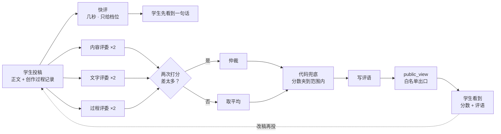

# 架构：一场 AI 征文比赛是怎么搭起来的

## 先说清楚这场比赛在比什么

表面是征文比赛，内核是**让学生练怎么驱动 AI 的靶场**。

作品都是学生用 AI 写的。比的不是 AI 写得多好，是人在中间做了多少判断：
写哪件事、毙掉哪一稿、哪句话不让 AI 碰。所以每篇投稿除了正文，还要交一份**创作过程记录**。

一句话：**征文不是一个赛道，它是一种教学形式的设计。**

整套系统只为一个循环服务：

```
投稿 → 十几秒拿到快评 → 几十秒拿到分数和评语 → 回去改 → 再投
```

每人每小时最多投 3 次。这个循环转得越快、评语越准，学生改得越多。

## 全貌



每个评委背后不是固定的一个模型，而是一个**候选池**，按轮转派活，挂了自动换。

## 七个设计，对应仓库里的代码

### 1. 两段式评分：先给档位，再给分数

`engine/review.py: quick()` · `rubrics/quick.md`

详评要几十秒。让学生干等，体验很差。所以先由一个快模型几秒内给出**档位**
（白纸 / 毛坯 / 起稿 / 有骨 / 成篇 / 定稿）和一句话。

快评**不许给分数**。一个模型的分数和评委团对不上，先说 70 再改成 55，比不说更伤人。

### 2. 多评委、每人打两次、分差大就仲裁

`engine/review.py: judge_twice()` · `rubrics/arbiter.md`

五个维度分给三位评委，各管一块。每位评委打两次，轮换会把两次派给不同模型。
同一维度两次分差超过阈值，交给仲裁模型看双方证据裁决，不是简单取平均。

这样做的原因：同一篇文章重打一次，总分能差出 ±13 分。单个模型打一次分，排名就是噪声。

### 3. 多模型轮换 + 熔断 + 备用链

`engine/llm.py: next_in_rotation() / mark_fail() / ask()`

- **轮转，不随机。** 随机会让某一家连续被抽中，反而先被打爆
- **熔断。** 连续失败 3 次就冷却 3 分钟，不再派活
- **备用链。** 当前模型失败，按池子往下换，学生不会因为某家模型打嗝白丢一次机会
- **池子里每一项必须是 provider + model 成对。** 只换 provider 会把 A 家的模型名发给 B 家

换模型只改 `config/models.json`，代码一行不动。

### 4. 内规和外规分家

`config/rules.*.json` 的 `internal` · `engine/leak_check.py` · `engine/review.py: public_view()`

学生知道题目和五个维度。**怎么拿高分的细则不告诉他们**，让他们自己找，而不是照着刷。

- 内规只写在一个地方（`internal`），只会被拼进评委的 system prompt
- 所有对外的东西只走 `public_view()` 一个出口，按白名单挑字段。以后加了新的内部字段，默认也漏不出去
- `leak_check` 自动扫对外的文件和接口返回，内规里的任何一个词出现就报错。比赛中它真的抓到过好几处漏网

### 5. 能算的规则用代码兜，不写在 prompt 里

`engine/review.py: clamp()` 和 `quick()` 里的档位检查

在 prompt 里写「每人最多两个奖」，模型照样发三个；写「分数不能超过满分」，它照样给 25/20。
凡是能用一个 if 判断的，就别指望模型记住：分数夹到范围内，自创的档位直接丢掉，评奖数量由代码数。

### 6. 校准闸门：评分卡上线前先证明自己分得出好坏

`engine/calibrate.py`

拿两篇应该拉开差距的样文（仓库里是一篇好范文和一篇反面示范），各跑 3 次。
**两篇的平均分差必须大于单篇自己重跑的波动**，不过就不许上线。改评分卡之后、换模型之后都要重跑。

### 7. 用量旁路记账

`engine/llm.py: record_usage()`

每次成功调用，把 API 返回的 token 用量追加一行到 `data/usage.jsonl`。四条铁律：

1. 整段 try/except 包住，记账坏了也不影响评分
2. 不改调用方的返回值
3. 只记成功的调用
4. 失败要吼一声。空账本会被读成「没花钱」，比报错更危险

**第一天就要开。** 用量事后无法追溯。

## 这个仓库没有的东西

- **比赛实际用的评分卡和内规。** 仓库里的 `rubrics/` 是模板，`config/rules.example.json` 是示例值
- **线上的网站和服务端。** 报名、投稿、榜单、阅览室这些页面可以在 [weyoung.winnielyu.com](https://weyoung.winnielyu.com) 看到
- **任何一篇参赛作品和个人信息。** `stats/` 里只有汇总数字

`engine/` 是从比赛代码里抽出来的通用部分，改写成了一个能独立跑的参考实现。
